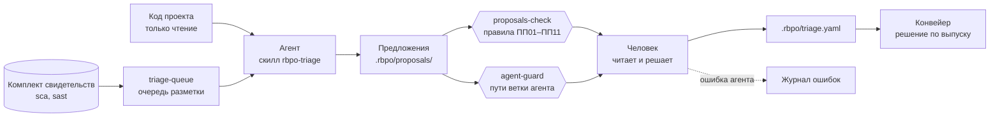

# Набор для ИИ-агента: предложения по разметке

Набор для проекта, который выпускается через rbpo-pipeline и хочет поручить ИИ-агенту разбор
срабатываний статического анализа и уязвимостей зависимостей. Агент готовит предложения, решение
принимает человек. Устройство, правила проверки и угрозы описаны в
[`docs/agent.md`](../docs/agent.md).

## Состав

| Файл | Назначение |
|---|---|
| [`AGENTS.template.md`](AGENTS.template.md) | правила для агента: что делает, что запрещено, когда остановиться. В проекте файл называется `AGENTS.md` |
| [`skills/rbpo-triage/SKILL.md`](skills/rbpo-triage/SKILL.md) | скилл в формате Agent Skills: порядок разбора очереди, таблица решений, формат предложений |
| [`skills/rbpo-triage/assets/proposals.example.yaml`](skills/rbpo-triage/assets/proposals.example.yaml) | образец файла предложений с пояснениями |
| [`ERRORS.md`](ERRORS.md) | журнал ошибок агента: классы ошибок, формат записи, сводка по прогонам |
| [`PMI.md`](PMI.md) | программа и методика испытаний связки «оболочка, модель, скилл, правила» |
| [`stand/`](stand/README.md) | стенд с известными ответами и тремя ловушками, сверка с эталоном |
| [`workflows/agent-guard.yml`](workflows/agent-guard.yml) | пример рабочего процесса: запрос на слияние из ветки агента меняет только каталог предложений |

Шаблон правил назван `AGENTS.template.md`, а не `AGENTS.md`: оболочки агентов читают `AGENTS.md`
как указания для каталога, в котором он лежит, и применили бы правила разметки к работе над самим
rbpo-pipeline.

## Подключение в проекте

1. Скопируйте `AGENTS.template.md` в корень проекта под именем `AGENTS.md`, каталог `skills/` — в
   корень проекта или туда, где ваша оболочка агента ищет скиллы. `AGENTS.md` ссылается на скилл
   по пути, поэтому набор работает и в оболочках без поддержки скиллов.
2. Установите rbpo-pipeline в окружение агента тем же закреплённым коммитом, что и в конвейере.
3. Дайте агенту комплект свидетельств из запуска конвейера: артефакт `rbpo-evidence` или
   `rbpo-part-analyze`, распакованный в `.rbpo-evidence/`. Комплект из рабочего каталога агента для
   проверки предложений не используйте.
4. Ограничьте агента средствами оболочки и репозитория: файловая система проекта, без сети и без
   запуска кода; отдельная учётная запись с правом отправки только в ветки `agent/**`;
   [`workflows/agent-guard.yml`](workflows/agent-guard.yml) как обязательная проверка; `CODEOWNERS`
   для `.rbpo/triage.yaml`, `rbpo.yaml` и `.github/`.
5. До работы на проекте прогоните связку на стенде по [`PMI.md`](PMI.md).

Задание агенту: «Разбери очередь разметки по скиллу rbpo-triage. Комплект свидетельств —
`.rbpo-evidence`». После работы агента человек читает отчёт проверки (`<имя>.md`) и заметки агента
(`<имя>.notes.md`), сам проверяет выводы и переносит принятые решения в `.rbpo/triage.yaml` своим
коммитом.

## Что проверено

- Команды `triage-queue`, `proposals-check`, `agent-guard` покрыты тестами
  (`tests/test_proposals.py`), в том числе на 45 враждебных и 8 испорченных файлах предложений.
- Стенд собирается, эталонный ответ проходит проверку и сверку с эталоном
  (`tests/test_agent_stand.py`).
- Образец предложений, перечень правил в документации и упомянутые в текстах команды сверяются с
  кодом тестами.

Не проверено: прогоны настоящего агента на стенде не выполнялись, журнал ошибок и протокол пусты;
пример рабочего процесса проверен только статически (actionlint) и в живом репозитории не запускался.
