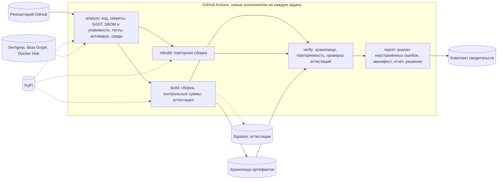

# Руководство по РБПО демонстрационного проекта

Документ собирает в одном месте регламенты и сведения, которые конвейер `rbpo-pipeline` не может
получить автоматически. Стандарт допускает оформлять регламенты нескольких процессов одним
документом; разделы ниже соответствуют артефактам ГОСТ Р 56939-2024, номера указаны в каждом
разделе.

Руководство написано для демонстрационного проекта и показывает, какие сведения ожидаются. В
реальном проекте его нужно переработать под свою организацию, роли и инфраструктуру.

## Роли

| Роль | Обязанности |
|---|---|
| Разработчик | вносит изменения через запросы на слияние, размечает срабатывания анализаторов в своих изменениях, исправляет ошибки |
| Ответственный за выпуск | принимает решение о выпуске по сводке конвейера, подтверждает решения о принятых ошибках и уязвимостях |
| Ответственный за РБПО | сопровождает это руководство, настройки `rbpo.yaml` и файл разметки, пересматривает набор правил и пороги |

В демонстрационном проекте все роли исполняет один человек.

## Управление конфигурацией

Регламент управления конфигурацией (артефакт 5.4.3.1).

- Все элементы конфигурации хранятся в репозитории git; единственный источник выпускаемой
  версии — ветка `main` и теги выпусков вида `vX.Y.Z`.
- Изменение вносится запросом на слияние; сообщение коммита или запроса ссылается на задачу в
  GitHub Issues, если изменение исправляет ошибку.
- Выпуск — тег на коммите ветки `main`, для которого конвейер принял решение «выпуск допустим».
- Свидетельства контроля изменений формирует конвейер для каждого запуска: перечень коммитов и
  изменённых файлов с разделением на ПО и документацию (`source/changes.json`, артефакт 5.4.3.3).

## Элементы конфигурации

Перечень элементов конфигурации (артефакт 5.4.3.2).

| Элемент | Где | Версионирование |
|---|---|---|
| Исходный код библиотеки и утилиты | `src/demo_app/` | git, теги выпусков |
| Тесты | `tests/` | git |
| Описание сборки и зависимостей | `pyproject.toml`, `requirements.txt` | git; версия бэкенда сборки и зависимостей закреплена |
| Настройки конвейера и решения по срабатываниям | `rbpo.yaml`, `.rbpo/triage.yaml` | git |
| Документация, включая это руководство | `README.md`, `docs/` | git |
| Конвейер сборки и проверок | `.github/workflows/` репозитория rbpo-pipeline | git; действия закреплены SHA |
| Результаты сборки | артефакты рабочего процесса `dist` | контрольные суммы SHA-256, аттестации |

## Статический анализ

Регламент статического анализа (артефакт 5.10.3.1).

- **Инструмент.** Semgrep Community Edition, версия закреплена в конвейере; набор правил
  `p/python`. Перечень инструментов с версиями и покрытием языков конвейер формирует сам
  (`sast/tools.json`, артефакт 5.10.3.2).
- **Когда.** На каждый запрос на слияние, каждую отправку в `main` и еженедельно.
- **Порог.** Срабатывания уровня `error` блокируют выпуск, пока по ним нет решения.
- **Разметка.** Решение по срабатыванию записывается в `.rbpo/triage.yaml`: правило, файл,
  вердикт (ложное, принято, подтверждено) и обоснование. Ложные и принятые срабатывания
  попадают в отчёт SARIF как подавленные с обоснованием; подтверждённые исправляются до выпуска.
  Решение о принятой ошибке подтверждает ответственный за выпуск.
- **Пересмотр настроек.** Набор правил и порог пересматриваются при появлении в проекте нового
  языка, при обновлении версии анализатора и если доля ложных срабатываний заметно выросла.
  Изменение настроек проходит через запрос на слияние.
- **Повторный анализ** выполняется автоматически при следующем запуске конвейера после
  исправления.

## Система сборки

Регламент использования безопасной системы сборки (артефакт 5.12.3.1).

- Выпускаемые пакеты собираются только в GitHub Actions на исполнителях GitHub (новая
  виртуальная машина на каждую задачу). Локальные сборки служат только для разработки.
- Сборка: `python -m build` с бэкендом hatchling; версия бэкенда закреплена в `pyproject.toml`.
- Каждая сборка повторяется на втором исполнителе; выпуск допускается, только если результаты
  совпали побитово.
- Результаты сборки сопровождаются контрольными суммами SHA-256 и аттестацией происхождения.

## Рекомендации по инструментам сборки

Перечень выполненных рекомендаций производителей инструментов сборки (артефакт 5.12.3.3).

| Рекомендация | Источник | Как выполнена |
|---|---|---|
| Закреплять версию бэкенда сборки | документация hatchling | `hatchling==1.32.4` в `[build-system]` |
| Использовать `SOURCE_DATE_EPOCH` для воспроизводимых архивов | документация hatchling, reproducible-builds.org | конвейер задаёт время последнего коммита |
| Собирать в изолированном окружении | документация `build` (PyPA) | `python -m build` создаёт изолированное окружение |
| Закреплять сторонние действия полным SHA коммита | руководство GitHub по защите Actions | все `uses:` закреплены SHA |
| Давать токену задачи минимальные права | руководство GitHub по защите Actions | права заданы для каждой задачи отдельно |
| Не сохранять учётные данные при получении кода | документация `actions/checkout` | `persist-credentials: false` |
| Подтверждать происхождение результатов | документация GitHub Artifact Attestations | `actions/attest-build-provenance` |

## Безопасность сборочной среды

Регламент обеспечения безопасности сборочной среды (артефакт 5.13.3.1).

- **Исполнители.** Только размещённые исполнители GitHub; каждая задача выполняется на новой
  виртуальной машине, состояние между задачами не переносится.
- **Секреты.** Долгоживущие секреты в сборке не используются; для аттестаций — краткоживущий
  токен OIDC.
- **Права.** Токен задачи получает только те права, которые ей нужны; запись аттестаций —
  только у задач сборки и выпуска комплекта.
- **Изменения конвейера.** Ветка `main` защищена: рабочие процессы и настройки конвейера
  меняются только через запрос на слияние с проверкой (в демонстрационном репозитории защита
  ветки не настроена).
- **Ожидаемые результаты.** Колесо и архив исходного кода в `dist/`; перечень и контрольные
  суммы — в `build/SHA256SUMS` комплекта свидетельств.
- **Журналы аудита.** Журнал сборки, сведения о ней и сведения о среде входят в комплект
  свидетельств; комплект подписан аттестацией, поэтому изменение журнала после сборки
  обнаруживается.
- **Хранение результатов.** Результаты хранятся как артефакты рабочего процесса; после загрузки
  из хранилища они сверяются с контрольными суммами сборки. Для выпусков комплект свидетельств
  прикладывается к выпуску GitHub.
- **Каналы к внешним источникам** — только HTTPS; загружаемые инструменты проверяются по SHA-256.

## Сведения о безопасности сборочной среды

Сведения о безопасности сборочной среды (артефакт 5.13.3.2).

- Образ исполнителя `ubuntu-latest`; точная версия образа записывается при каждом запуске
  (`env/environment.json`, артефакт 5.12.3.2).
- Версии инструментов анализа и SHA-256 их архивов закреплены в `rbpo_pipeline/tools.json`;
  фактические версии сверяются при каждом запуске.
- Права токена по задачам: анализ и повторная сборка — только чтение кода; сборка и выпуск
  комплекта — чтение кода, токен OIDC, запись аттестаций; проверка — чтение кода и аттестаций.
- Внешние источники: GitHub (код, действия, инструменты), PyPI (пакеты Python), Docker Hub
  (образ ClamAV), реестр правил Semgrep, база уязвимостей Grype.
- Повторяемость сборки проверяется на каждом запуске (артефакт 5.13.3.6).

## Схема сборочной среды

Схема сборочной среды (артефакт 5.13.3.3).



## Доступ к исходному коду и его целостность

Регламент управления доступом к исходному коду и обеспечения его целостности (артефакт 5.14.3.1).

- Доступ к репозиторию выдаётся по ролям (см. модель доступа ниже) и пересматривается при
  смене состава участников.
- Изменения попадают в `main` только через запрос на слияние с проверкой конвейером.
- При каждом запуске конвейер проверяет, что сборка идёт из закоммиченного кода (рабочее дерево
  не изменено), фиксирует хэш дерева и SHA-256 архива исходного кода, проверяет подписи коммитов
  через GitHub (`source/integrity.json`, артефакт 5.14.3.3).
- Подписи коммитов в демонстрационном проекте фиксируются, но не требуются (`commit_signatures:
  report`). Для рабочего проекта рекомендуется режим `require`: коммит без проверенной подписи
  опровергает целостность и останавливает выпуск.

## Модель доступа к коду

Описание модели управления доступом к исходному коду (артефакт 5.14.3.2).

| Субъект | Права в репозитории | Что может |
|---|---|---|
| Любой пользователь (репозиторий публичный) | чтение | читать код, предлагать изменения из своей копии |
| Разработчик | запись | создавать ветки и запросы на слияние |
| Ответственный за выпуск | сопровождение | принимать запросы на слияние, создавать теги выпусков |
| Владелец репозитория | администрирование | менять настройки, защиту веток, доступ |
| Токен задачи конвейера | по задаче: чтение кода; для сборки — токен OIDC и запись аттестаций | только действия своей задачи в пределах запуска |

## Композиционный анализ

Регламент композиционного анализа (артефакт 5.16.3.1).

- **Перечень зависимостей.** Формируется Syft из `requirements.txt` при каждом запуске, формат
  CycloneDX (артефакт 5.16.3.2). Зависимости времени выполнения закреплены точными версиями.
- **Известные уязвимости.** Проверяются Grype по актуальной базе непосредственно перед сборкой,
  в той же цепочке задач (артефакт 5.16.3.4).
- **Порог.** Уязвимости уровня `high` и `critical` блокируют выпуск, пока по ним нет решения.
- **Решения.** Записываются в `.rbpo/triage.yaml`: идентификатор (CVE или GHSA), пакет, вердикт
  (не затрагивает, принято, подтверждено) и обоснование; для принятых указывается срок
  пересмотра.
- **Компенсирующие меры.** Предпочтительно обновление зависимости; если обновления нет —
  исключение уязвимой функции из использования или замена компонента; решение и обоснование
  фиксируются в файле разметки.
- **Периодичность.** Каждый запрос на слияние, каждая отправка в `main` и еженедельный запуск,
  который ловит уязвимости, опубликованные после последнего изменения кода.

## План функционального тестирования

План функционального тестирования (артефакт 5.18.3.1).

- **Объекты.** Модуль `demo_app.manifest` (построение, запись, чтение и проверка манифеста) и
  утилита `demo-manifest` (команды `build` и `verify`).
- **Уровни.** Модульные тесты функций и тесты утилиты целиком через её точку входа.
- **Что проверяется.** Порядок и относительные пути в манифесте; обнаружение изменённых,
  отсутствующих и лишних файлов; отказ от путей за пределами каталога; отказ от манифеста
  неизвестного формата; коды возврата утилиты.
- **Среда.** Исполнитель GitHub Actions, версия Python из настроек конвейера; pytest с отчётом
  JUnit.
- **Когда.** При каждом запуске конвейера, до сборки.
- **Критерий.** Все тесты пройдены; непройденный тест опровергает отчёт о тестировании
  (артефакт 5.18.3.2) и останавливает выпуск.
- **Результаты.** Отчёт JUnit и журнал запуска входят в комплект свидетельств
  (артефакты 5.18.3.2 и 5.18.3.3).

## Система управления ошибками

Сведения о системе управления ошибками (артефакт 5.18.3.4).

- Ошибки регистрируются в GitHub Issues репозитория с меткой `bug`; в описании — шаги
  воспроизведения и ссылка на запуск конвейера, где ошибка проявилась.
- Исправление вносится запросом на слияние со ссылкой на задачу (`Fixes #N`); задача
  закрывается автоматически при слиянии.
- Непройденный тест в конвейере — основание завести задачу, если ошибку не исправляют в том же
  запросе на слияние.

## Приёмка

Регламент приёмки ПО (артефакт 5.20.3.1).

- Версия принимается, если для её коммита конвейер принял решение «выпуск допустим», а сводка
  не содержит опровергнутых технических артефактов.
- Ответственный за выпуск просматривает сводку конвейера и анализ неустранённых ошибок
  (`release/unresolved.json`, артефакт 5.20.3.2): каждое принятое срабатывание и каждая
  принятая уязвимость должны иметь обоснование и срок пересмотра.
- После приёмки ставится тег выпуска; комплект свидетельств и `SHA256SUMS` прикладываются к
  выпуску GitHub.

## Целостность ПО для пользователей

Регламент обеспечения целостности ПО при передаче пользователям (артефакт 5.20.3.3).

- Каждый результат сборки сопровождается контрольной суммой SHA-256 (`build/SHA256SUMS`) и
  аттестацией происхождения, подписанной через Sigstore от имени рабочего процесса
  rbpo-pipeline.
- Пользователь проверяет файл так:

  ```sh
  sha256sum -c SHA256SUMS
  gh attestation verify rbpo_demo_app-0.1.0-py3-none-any.whl --repo alexqzm/rbpo-pipeline \
    --signer-workflow alexqzm/rbpo-pipeline/.github/workflows/rbpo.yml
  ```

- Конвейер выполняет ту же проверку после каждой сборки (артефакт 5.20.3.4).
